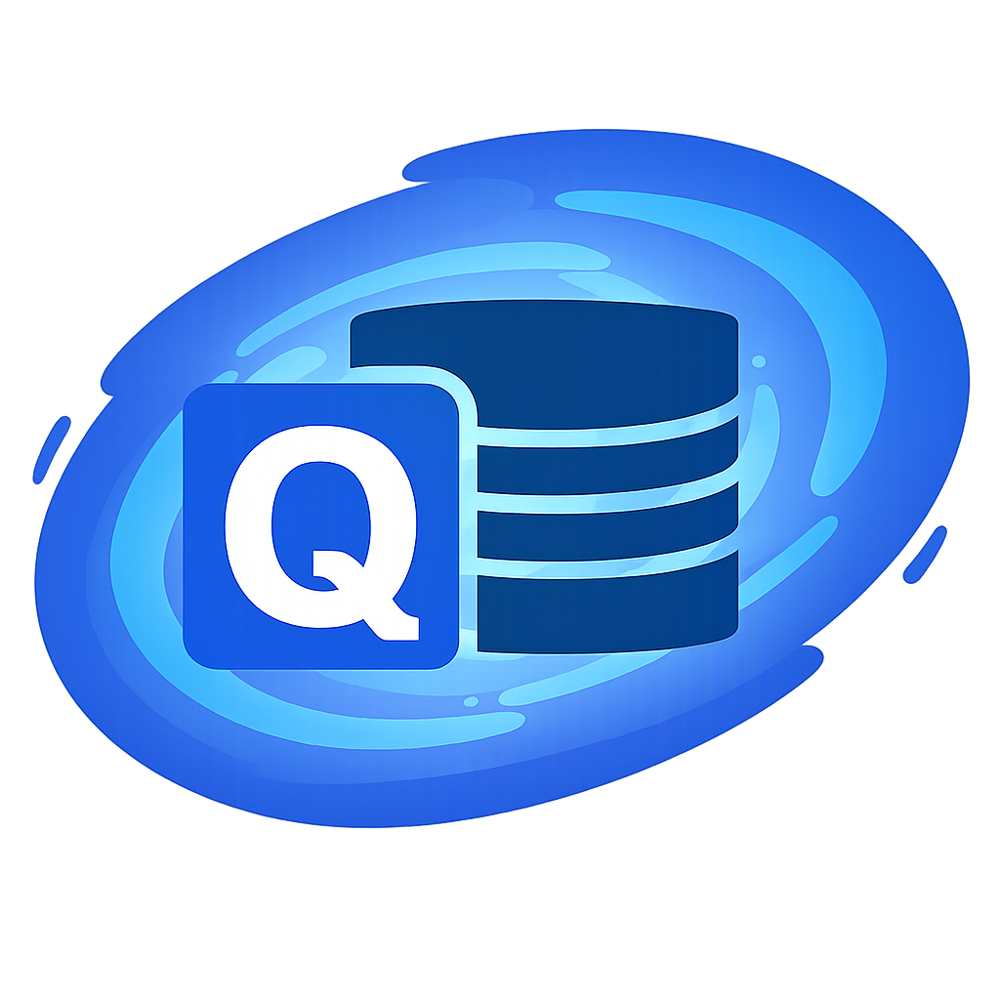

<h1 align="left">QueryVerse
  
</h1>

Perform SQL queries against [Microsoft Dataverse](https://learn.microsoft.com/en-us/power-apps/maker/data-platform/data-platform-intro) from a desktop client tuned for fast everyday workflows.

## What is QueryVerse?

QueryVerse is a Dataverse-focused SQL client. It emphasizes:

- fast SQL-to-Fetch execution
- practical multi-connection desktop workflows
- schema-aware query authoring
- safe update/delete flows with preview and confirmation

This README is the product index. Detailed breakdowns live in [`doc/`](doc).

## Who is it For?

- Developers who need a fast Dataverse-native query tool without living in raw FetchXML.
- Functional consultants who want to inspect data, validate joins, and save reusable SQL.
- Power users who need a desktop workflow for query execution, schema browsing, and export.

## Features

### Query Editor and Tabs

SQL editing, multi-query files, per-tab connections, FetchXML preview tabs, and statement-scoped intellisense.

See [doc/query-editor.md](doc/query-editor.md).

### Connections and Project Organization

Saved Dataverse connections, folders, per-tab connection binding, context menus, editing, deleting, and manual reordering.

See [doc/connections.md](doc/connections.md).

### Schema Explorer

Connection-scoped schema browsing for entities, attributes, and relationships.

See [doc/schema-explorer.md](doc/schema-explorer.md).

### Write Operations

`UPDATE` and `DELETE` support, preview-before-confirm flows, request-parameter awareness, and row-count previews.

See [doc/write-operations.md](doc/write-operations.md).

### SQL Support

Supported SQL statement families, query-oriented editor behavior, and current SQL feature boundaries.

See [doc/sql-support.md](doc/sql-support.md).

### Results and Export

Virtualized result grid behavior, copy workflows, row numbering, inline errors, and export-related behavior.

See [doc/results-and-export.md](doc/results-and-export.md).

### Settings and Developer Workflow

App settings, CLI parameters, Vim mode, keyboard shortcuts, and multi-instance dev workflow.

See [doc/settings-and-cli.md](doc/settings-and-cli.md).

### Not Supported / Known Limitations

Current gaps, intentional omissions, and behavior that users should understand before depending on a workflow.

See [doc/limitations.md](doc/limitations.md).

## Current Feature Summary

- Execute Dataverse SQL queries from a desktop client.
- Translate SQL to FetchXML.
- Preview generated FetchXML before execution.
- Run paged Dataverse reads.
- Open multiple query tabs.
- Associate runnable tabs with saved Dataverse connections.
- Create, edit, delete, reorder, and organize connections and folders.
- Open SQL files from disk and save them back to disk.
- Open SQL files and selected connections from CLI startup parameters.
- Browse Dataverse schema metadata.
- Support `SELECT`, `UPDATE`, and `DELETE` statement workflows.
- Execute `UPDATE` and `DELETE` statements with preview-before-confirm flow.
- Show query results in a virtualized grid with row numbers and inline errors.
- Configure editor, shortcut, Vim, and Dataverse request-parameter settings.

## AI Disclosure

Portions of this project were developed with the assistance of AI tools; all changes are reviewed and tested by maintainers.

## Acknowledgements

QueryVerse is lovingly inspired by the [SQL4CDS](https://www.xrmtoolbox.com/plugins/MarkMpn.SQL4CDS/) project. <3
